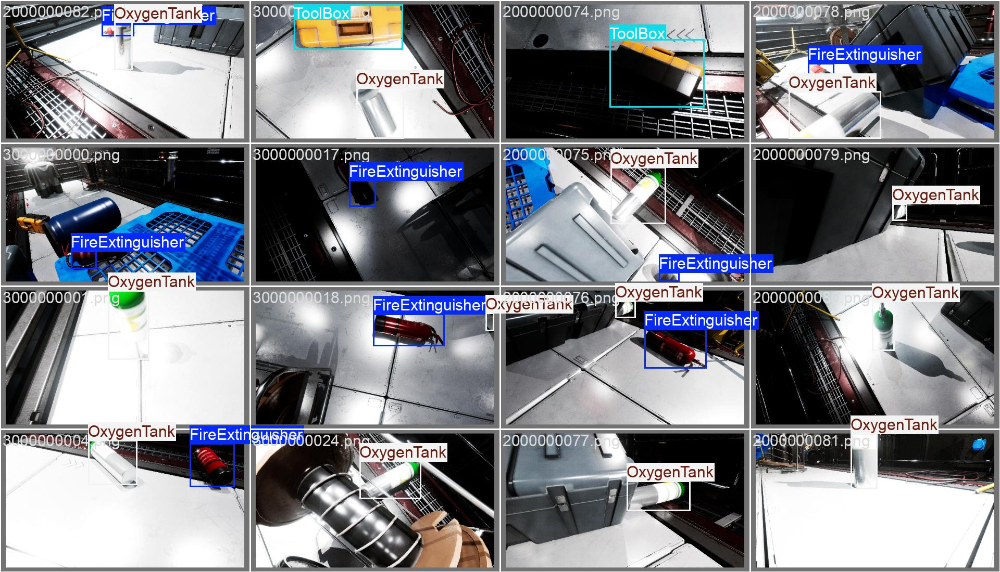

# 🚀 YOLOv8 Object Detection for Industrial Safety Environments

> **YOLOv8 Object Detection for Industrial Safety. A shared-task machine learning project using YOLOv8l to detect Fire Extinguishers, Toolboxes, and Oxygen Tanks with 85.1% mAP@0.5. Includes training notebook, evaluation visuals, and full technical shared task paper.**  
> Developed as part of a university-level ML competition  
> 📍 FAST NUCES Karachi · 🧑‍💻 Hani Siraj

---

## 📌 Project Summary

This project applies the **YOLOv8l** object detection model to identify three critical object types frequently found in industrial and safety-critical environments:

- 🔥 Fire Extinguisher  
- 🧰 Toolbox  
- 🧪 Oxygen Tank

The pipeline covers end-to-end stages: **data preparation**, **augmentation**, **training**, **fine-tuning**, and **evaluation** — with a strong focus on real-world robustness including occlusion handling and lighting challenges.

---

## 🧠 Objective

Build an accurate and efficient object detection model using **YOLOv8**, and optimize it to achieve the highest possible **mAP@0.5** score under practical constraints.

---

## 📁 Dataset

- **Total Images**: 1,139
- **Classes**: 3 (Balanced)
- **Format**: YOLO-annotated bounding boxes
- **Split**: 80% Training / 20% Validation
- **Preprocessing**:
  - Resizing to 640x640
  - Class balancing
  - Label smoothing
  - Occlusion-aware augmentation

---

## ⚙️ Model Configuration

| Setting         | Value              |
|----------------|--------------------|
| Model           | YOLOv8l            |
| Image Size      | 640x640            |
| Epochs          | 50                 |
| Batch Size      | 16                 |
| Optimizer       | SGD                |
| Learning Rate   | 0.005              |
| Augmentation    | Mosaic, HSV, Flip  |
| Label Smoothing | 0.1                |
| Early Stopping  | Enabled (patience 5)|

---

## 📈 Performance

- **Final mAP@0.5**: **85.1%**

| Problem                     | Fix Applied                          | Result         |
|----------------------------|--------------------------------------|----------------|
| Occlusion hurting recall   | Occlusion-aware augmentation         | +7% Recall     |
| Early overfitting          | Early stopping & tuned epochs        | +3% Precision  |
| Minor class imbalance      | Weighted sampling                    | +1% mAP        |
| Lighting variation         | HSV brightness + label smoothing     | Better robustness |

---

## 🔍 Results & Visuals

### 📊 Training Metrics

*Include your loss curves, mAP plots here*


---

### 🔎 Sample Detections

*Predictions on validation images*



---

### 🔀 Confusion Matrix

*Highlight class-wise confusion*


---

### ❌ Failure Cases & Insights

While the model achieved strong overall performance, it faced challenges in certain real-world scenarios:

- **Low Lighting Conditions**: Toolbox detection failed in dark environments.
- **Partial Occlusion**: OxygenTanks were frequently missed when partially hidden behind other objects.

These failures guided targeted augmentation strategies, such as HSV brightness adjustment and occlusion-aware transforms.

#### 🔎 Visual Example

| Model Prediction Output | Ground Truth Labels |
|-------------------------|---------------------|
|  |  |

In this example, the model fails to detect the toolbox in low-light conditions (left), while the ground truth clearly labels it (right).

#### 🔧 Adjustments Made

```python
hsv_h = 0.015
hsv_s = 0.7
hsv_v = 0.7  # Increased brightness
mosaic = 0.8
```

---

## 📄 Full Technical Paper

Read the full shared task-style research paper with methodology, results, and improvements:

📄 [View the Paper on Overleaf (LaTeX)](https://www.overleaf.com/read/ccyfrshtygxq#c70f4d)  
📥 [Download as PDF](https://www.overleaf.com/download/project/6875152bf9087c66b8e4f3ce/build/1980988aede-f8c3828727378e11/output/output.pdf?compileGroup=standard&clsiserverid=clsi-reg-n2d-b-f-gls8&enable_pdf_caching=true&popupDownload=true)

---

## 👨‍💻 Author

**Hani Siraj**  
AI Undergraduate — FAST NUCES Karachi  
📧 haanisiraj@email.com  
🌐 [LinkedIn](https://pk.linkedin.com/in/hani-s-24b3a2209?trk=people-guest_people_search-card) · [Portfolio](https://your-site.com)

---

## 📌 Future Work

- Try YOLOv9 (anchor-free) for benchmark comparison
- Use SAM (Segment Anything Model) for better ROI selection
- Apply `evolve` for hyperparameter tuning
- Convert model to TorchScript or ONNX for deployment

---

## 🤝 Acknowledgment

Project developed with support from fellow students at FAST NUCES Karachi.

**Teammates:**
- Hasan Abdul — k228727@nu.edu.pk  
- Sajad Ali — k228729@nu.edu.pk


---

